# LexCrawl — API Architecture Discovery Report

- **Date:** 2026-11-05
- **Branch / HEAD:** `main` / `149e2324425fdeaa372df0ecfabc0c62f2059a06`
- **Type:** read-only architecture discovery for a future FastAPI layer
- **Changes made:** none. No code, configuration, migrations, or database records were modified; no dependencies installed; nothing committed. Secrets are never printed.
- **Verified facts vs. proposals:** statements are marked **[verified]** (read from the current code) or **[recommendation]** / **[assumption]**.

---

## 1. Executive summary

LexCrawl today is a **crawling and ingestion system**, not a service. It has a mature, tested pipeline (491 tests) that discovers, extracts, validates, canonicalizes, and persists legal/regulatory documents from three sources into a well-normalized PostgreSQL schema. The `api/` and `scheduler/` packages are **empty** (`src/lexcrawl/api/__init__.py`, `api/routes/__init__.py`, `scheduler/__init__.py` are 0 bytes) and `tests/api/` contains only `__init__.py`.

Key facts for API design:

- **The data model is API-ready [verified].** `documents`, `document_localizations`, `document_resources`, `crawl_runs`, `crawl_run_sources`, `crawl_errors`, and `sources` are fully normalized with stable identity keys, SHA-256 content hashes, `TEXT-BEGIN` text, statuses, counters, and timestamps.
- **The persistence layer is write-oriented [verified].** Repositories provide upserts plus two read helpers (`known_identity_keys`, `incomplete_reports`). There are **no list/get/pagination/filter query methods** yet.
- **Crawl execution is synchronous and CLI-driven [verified].** `run_crawl(actors, fetcher)` (`orchestrator.py:75`) runs actors sequentially in-process; `cli.main` (`cli.py:374`) wires fetchers, JSON output, and optional persistence.
- **API configuration already exists [verified].** `Settings` declares `api_host`, `api_port`, `api_page_size_default`, `api_page_size_max` (`config.py:37-40`); `fastapi`, `uvicorn`, and `APScheduler` are already declared dependencies (`pyproject.toml:10-24`) but unused.
- **A crawl trigger cannot simply call the CLI path inline [verified].** UAE runs use the browser + `RotatingFetcher` and the Commerce path may spend Firecrawl credits; both are long-running (tens of seconds to minutes) and synchronous, so an HTTP request should not run them in the request/response cycle.

**Conclusion:** a read-only document/source/run API is achievable with small additions (query methods + schemas + routers). A crawl-trigger API requires a **job/execution boundary** (in-process background task with a lock, or an out-of-process worker), and must **not** re-implement actor/orchestration/persistence logic. This report defines the concrete endpoints, schemas, and sequence.

---

## 2. Relevant repository structure

**[verified]** Module inventory (responsibility → how it interacts):

| Module | Responsibility | Interacts with |
| --- | --- | --- |
| `cli.py` | Argparse entry point (`lexcrawl`), wires actors/fetchers, prints summary, writes JSON, optional `--persist`; `db` subcommands (`upgrade/current/revision/seed`). | config, actors, crawling, orchestrator, persistence, db |
| `config.py` | `Settings` (pydantic-settings) incl. DB, crawl policy, API, Firecrawl, source locations; `get_settings()` cache. | everything |
| `logging.py` | `configure_logging()`, JSON/console formatters, `get_logger()`. | all processes |
| `orchestrator.py` | `CrawlRunReport`, `run_crawl(actors, fetcher)` — sequential, isolated per actor; `summary()` dict. | actors, crawling, models |
| `actors/base.py` | `Actor` ABC (`run`), `ActorRunResult` (counters, `status`, `check_outcome`), `RunStatus`/`CheckOutcome`. | crawling, models |
| `actors/{uae_legislation,cba,commerce}.py` | Source-specific discovery, detail extraction, canonicalization, resource handling. | crawling, validation, pipeline, models |
| `crawling/base.py` | `Fetcher` protocol, `FetchedPage`, typed errors (`FetchError`, `TransientFetchError`, `AccessBlockedError`, `ResponseTooLargeError`, …), `detect_bot_block`. | http/browser/rotating/firecrawl |
| `crawling/{http,browser,rotating,firecrawl}.py` | Transport: `HttpFetcher` (httpx), `BrowserFetcher` (Playwright), `RotatingFetcher` (session rotation on block), `FirecrawlClient` (Commerce). | actors, orchestrator |
| `crawling/{pacing,retry,robots}.py` | Request pacing, retry policy, robots.txt policy. | fetchers |
| `pipeline/{normalize,pdf}.py` | Text normalization/paragraph assembly; PDF text extraction (`TEXT-BEGIN`, hash, subprocess timeout). | actors, validation |
| `validation/{base,uae,cba,commerce}.py` | Source contracts and `ValidationReport`/`ValidationIssue`; URL/text/hash checks. | actors, models |
| `models/document.py` | **Canonical contract**: `CanonicalDocument`, `RawArticle`, `ArticleStub`, `DocumentResource`, `DocumentTranslation`; `stable_identity`, `compute_content_hash`, `ensure_text_marker`; status/kind Literals. | actors, pipeline, persistence |
| `persistence.py` | `persist_crawl_report` / `persist_source_result` / `persist_failed_source`; per-source transactions; `PersistedCrawlRun`. | repositories, db |
| `repositories/*.py` | Column mapping (`mapping.py`) and upsert helpers (`documents`, `localizations`, `resources`, `crawl_runs`) + `known_identity_keys`, `incomplete_reports`. | db/models, models |
| `db/{base,engine,session,seed}.py` | Metadata/naming conventions, engine, `session_scope`, source registry seed. | repositories, CLI, tests |
| `db/models/*.py` | SQLAlchemy ORM (7 tables). | migrations |
| `migrations/versions/0001..0006` | Schema history (head = `0006_doc_extraction_attempts`, applied). | db/models |
| `api/`, `scheduler/` | **Empty scaffolding** (0-byte `__init__.py`). | — |

---

## 3. Mermaid ER diagram

**[verified]** Relationships from the ORM (`db/models/*`):

```mermaid
erDiagram
    sources ||--o{ documents : "owns"
    sources ||--o{ crawl_run_sources : "is crawled by"
    documents ||--o{ document_localizations : "has languages"
    documents ||--o{ document_resources : "has attachments"
    documents ||--o{ crawl_errors : "may be attributed"
    document_localizations ||--o{ crawl_errors : "may be attributed"
    document_resources ||--o{ crawl_errors : "may be attributed"
    crawl_runs ||--o{ crawl_run_sources : "contains"
    crawl_run_sources ||--o{ crawl_errors : "records"

    sources {
        bigint id PK
        varchar code UK
        varchar name
        varchar base_url
        boolean is_active
        timestamptz created_at
        timestamptz updated_at
    }
    documents {
        bigint id PK
        bigint source_id FK
        text identity_key
        text native_id
        text source_url
        text listing_url
        varchar document_type
        date published_at
        smallint published_year
        smallint published_month
        varchar published_precision
        text published_date_raw
        text_array topics
        text image_url
        timestamptz source_created_at
        varchar provenance
        text archive_url
        timestamptz archived_at
        text archive_listing_url
        varchar extraction_status
        text extraction_error
        smallint extraction_attempts
        timestamptz first_seen_at
        timestamptz last_seen_at
        timestamptz created_at
        timestamptz updated_at
    }
    document_localizations {
        bigint id PK
        bigint document_id FK
        varchar language_code
        text title
        text summary
        text text_content
        varchar content_hash
        varchar status
        text source_url
        text listing_url
        date published_at
        text image_url
        text error
        timestamptz fetched_at
        timestamptz last_attempt_at
        timestamptz created_at
        timestamptz updated_at
    }
    document_resources {
        bigint id PK
        bigint document_id FK
        text identity_key
        text native_id
        text title
        text display_title
        text original_url
        varchar resource_type
        varchar mime_type
        bigint file_size_bytes
        integer page_count
        integer character_count
        text extracted_text
        varchar content_hash
        varchar extraction_status
        text extraction_error
        text archive_url
        timestamptz archived_at
        timestamptz first_seen_at
        timestamptz last_seen_at
        timestamptz created_at
        timestamptz updated_at
    }
    crawl_runs {
        bigint id PK
        uuid run_id UK
        varchar trigger_type
        varchar status
        timestamptz started_at
        timestamptz finished_at
        integer duration_ms
        timestamptz created_at
    }
    crawl_run_sources {
        bigint id PK
        bigint crawl_run_id FK
        bigint source_id FK
        varchar status
        integer listing_pages_attempted
        integer listing_pages_succeeded
        integer listing_pages_failed
        integer articles_discovered
        integer article_urls_deduplicated
        integer records_filtered_out
        integer detail_pages_attempted
        integer detail_pages_succeeded
        integer detail_pages_failed
        integer records_missing_required_fields
        integer records_without_text
        integer resources_discovered
        integer resources_processed
        integer resources_extracted
        integer resources_unavailable
        integer resources_failed
        integer resources_skipped
        integer documents_processed
        integer documents_failed
        integer documents_pending
        integer provider_credits_used
        varchar check_outcome
        boolean pagination_complete
        text error_summary
        timestamptz started_at
        timestamptz finished_at
    }
    crawl_errors {
        bigint id PK
        bigint crawl_run_source_id FK
        bigint document_id FK
        bigint localization_id FK
        bigint resource_id FK
        varchar stage
        varchar error_type
        text message
        boolean retryable
        timestamptz occurred_at
    }
```



---

## 4. Database model inventory

**[verified]** from `db/models/*` and migrations `0001..0006`. Naming convention prefixes constraints/indexes (`db/base.py:9-15`), e.g. `uq_documents_source_id_identity_key`.

### 4.1 `sources` (`db/models/source.py`)
- **PK:** `id` BIGINT IDENTITY.
- **Columns:** `code` VARCHAR(64) NOT NULL **UNIQUE**; `name` VARCHAR(200) NOT NULL; `base_url` VARCHAR(512) NULL; `is_active` BOOLEAN NOT NULL default `true`; `created_at`/`updated_at` TIMESTAMPTZ NOT NULL default `now()`.
- **Relationships:** `documents` (1:N), `run_sources` (1:N).
- **Seeded codes [verified]:** `uae_legislation_news`, `cba_news_releases`, `commerce_reports` (`db/seed.py:23-27`).

### 4.2 `documents` (`db/models/document.py:47-105`)
- **PK:** `id` BIGINT IDENTITY. **FK:** `source_id` → `sources.id` ON DELETE **RESTRICT**.
- **Unique:** `(source_id, identity_key)`.
- **Columns (selected):** `identity_key` TEXT NOT NULL; `native_id` TEXT NULL; `source_url` TEXT NOT NULL; `listing_url` TEXT NULL; `document_type` VARCHAR(64) NOT NULL; `published_at` DATE NULL; `published_year` SMALLINT NULL; `published_month` SMALLINT NULL; `published_precision` VARCHAR(8) NOT NULL default `'unknown'`; `published_date_raw` TEXT NULL; `topics` TEXT[] NOT NULL default `{}`; `image_url` TEXT NULL; `source_created_at` TIMESTAMPTZ NULL; `provenance` VARCHAR(16) NOT NULL default `'live'`; `archive_url`/`archived_at`/`archive_listing_url` NULL; `extraction_status` VARCHAR(24) NULL; `extraction_error` TEXT NULL; `extraction_attempts` SMALLINT NOT NULL default `0`; `first_seen_at`/`last_seen_at`/`created_at`/`updated_at` TIMESTAMPTZ NOT NULL.
- **Checks:** `published_precision ∈ {day,month,year,unknown}`; precision↔date rules; `published_month` 1–12 with year; `published_year` 1800–2100; `extraction_attempts >= 0`; `provenance ∈ {live,wayback}`; `extraction_status ∈ {pending,complete,failed,access_blocked,unavailable}` or NULL.
- **Indexes:** `(source_id, published_at DESC)`, `(source_id, last_seen_at DESC)`, `(source_id, document_type)`.
- **Relationships:** `source`, `localizations` (cascade delete), `resources` (cascade delete), `errors`.

### 4.3 `document_localizations` (`db/models/localization.py:31-67`)
- **PK:** `id`. **FK:** `document_id` → `documents.id` ON DELETE **CASCADE**. **Unique:** `(document_id, language_code)`.
- **Columns:** `language_code` VARCHAR(16) NOT NULL; `title` TEXT NULL; `summary` TEXT NULL; `text_content` TEXT NULL; `content_hash` VARCHAR(64) NULL; `status` VARCHAR(24) NOT NULL; `source_url`/`listing_url`/`image_url`/`error` TEXT NULL; `published_at` DATE NULL; `fetched_at`/`last_attempt_at` TIMESTAMPTZ NULL; `created_at`/`updated_at` NOT NULL.
- **Checks:** `status ∈ {not_configured,not_discovered,pending,complete,failed,access_blocked,unavailable}`; text↔hash pairing; `status='complete' ⇒ text_content IS NOT NULL`.
- **Index:** `(language_code, status)`.

### 4.4 `document_resources` (`db/models/resource.py:32-81`)
- **PK:** `id`. **FK:** `document_id` → `documents.id` ON DELETE **CASCADE**. **Unique:** `(document_id, identity_key)`.
- **Columns:** `identity_key` TEXT NOT NULL; `native_id` TEXT NULL; `title` TEXT NOT NULL; `display_title` TEXT NULL; `original_url` TEXT NULL; `resource_type` VARCHAR(16) NOT NULL; `mime_type` VARCHAR(128) NULL; `file_size_bytes` BIGINT NULL; `page_count` INT NULL; `character_count` INT NULL; `extracted_text` TEXT NULL; `content_hash` VARCHAR(64) NULL; `extraction_status` VARCHAR(24) NOT NULL; `extraction_error` TEXT NULL; archive fields NULL; `first_seen_at`/`last_seen_at`/`created_at`/`updated_at` NOT NULL.
- **Checks:** `resource_type ∈ {pdf,excel,word,csv,other}`; `extraction_status ∈ {pending,complete,not_applicable,access_blocked,failed,url_unavailable}`; text↔hash pairing; `complete ⇒ extracted_text`; `original_url IS NOT NULL OR extraction_status='url_unavailable'`; non-negative size/page/character counts.
- **Indexes:** `(document_id, extraction_status)`, `(extraction_status, updated_at DESC)`.

### 4.5 `crawl_runs` (`db/models/crawl_run.py:67-91`)
- **PK:** `id`. **Unique:** `run_id` UUID.
- **Columns:** `run_id` UUID NOT NULL; `trigger_type` VARCHAR(16) NOT NULL (`manual|scheduled`); `status` VARCHAR(24) NOT NULL (`running|success|partial_failure|failed`); `started_at` NOT NULL; `finished_at` NULL; `duration_ms` INT NULL; `created_at` NOT NULL.
- **Checks:** enum values; `duration_ms >= 0`; `finished_at >= started_at` (when set).
- **Indexes:** `(started_at DESC)`, `(status, started_at DESC)`.

### 4.6 `crawl_run_sources` (`db/models/crawl_run.py:94-147`)
- **PK:** `id`. **FK:** `crawl_run_id` → `crawl_runs.id` CASCADE; `source_id` → `sources.id` RESTRICT. **Unique:** `(crawl_run_id, source_id)`.
- **Columns:** `status` (RunStatus); 21 non-negative counters (`listing_*`, `articles_discovered`, `article_urls_deduplicated`, `records_filtered_out`, `detail_*`, `records_missing_required_fields`, `records_without_text`, `resources_*`, `documents_processed/failed/pending`, `provider_credits_used`); `check_outcome` VARCHAR(16) NULL (`no_change|new_data|check_failed`); `pagination_complete` BOOLEAN default false; `error_summary` TEXT NULL; `started_at`/`finished_at`.
- **Indexes:** `(source_id, started_at DESC)`, `(crawl_run_id, status)`.

### 4.7 `crawl_errors` (`db/models/crawl_error.py:35-69`)
- **PK:** `id`. **FK:** `crawl_run_source_id` → `crawl_run_sources.id` CASCADE; `document_id`/`localization_id`/`resource_id` → respective tables ON DELETE **SET NULL**.
- **Columns:** `stage` VARCHAR(16) NOT NULL (`discovery|fetch|parse|validate|extract|persistence|unknown`); `error_type` VARCHAR(64) NOT NULL; `message` TEXT NOT NULL; `retryable` BOOLEAN NULL; `occurred_at` NOT NULL.
- **Checks:** stage enum; `num_nonnulls(document_id, localization_id, resource_id) <= 1` (single attribution).
- **Indexes:** `(crawl_run_source_id, occurred_at DESC)`, `(error_type, occurred_at DESC)`.

**Entity relationships [verified]:** one `Source` owns many `Document`s; a `Document` owns many `DocumentLocalization` (per language) and `DocumentResource` (attachments); a `CrawlRun` contains many `CrawlRunSource` (one per source, unique) which own many `CrawlError`; a `CrawlError` may additionally point at one document/localization/resource. `identity_key` is stable and content-independent (`stable_identity`, `models/document.py:49`).

---

## 5. Repository and persistence contracts

**[verified]** Every repository takes a `Session` and commits via the caller's `session_scope` (`db/session.py:17`). Isolation: per-source transaction in `persist_crawl_report` (`persistence.py:242-253`).

| Function (file) | Signature | Filters/ordering/pagination | Behavior |
| --- | --- | --- | --- |
| `upsert_document` (`repositories/documents.py:17`) | `(session, *, source_id, document, now) -> int` | none | `INSERT … ON CONFLICT (source_id, identity_key) DO UPDATE`; nullable metadata via `coalesce`; `extraction_attempts` reset to 0 on `complete`, else +1; returns id. |
| `find_document` (`documents.py:65`) | `(session, *, source_id, identity_key) -> Document \| None` | exact | Single-row lookup. |
| `known_identity_keys` (`documents.py:72`) | `(session, *, source_code) -> set[str]` | source | All identity keys for one source. |
| `incomplete_reports` (`documents.py:93`) | `(session, *, source_code, max_attempts, limit=None) -> list[IncompleteReport]` | source + status≠complete + attempts<max; `order_by updated_at`; optional limit | **Read + ordering example**; returns a dataclass projection. |
| `upsert_localization` (`repositories/localizations.py:15`) | `(session, *, document_id, payload, now) -> int` | none | Upsert on `(document_id, language_code)`; `coalesce` keeps last good title/summary/text/hash; `status`/`error` overwritten; `fetched_at` set only on complete. |
| `upsert_resource` (`repositories/resources.py:16`) | `(session, *, document_id, resource, now) -> int` | none | Upsert on `(document_id, identity_key)`; keeps last good `extracted_text`/`content_hash`. |
| `create_run` (`repositories/crawl_runs.py:28`) | `(session, *, trigger_type, started_at, run_id=None) -> CrawlRun` | none | Inserts `status='running'`. |
| `upsert_run_source` (`crawl_runs.py:48`) | `(session, *, crawl_run_id, source_id, status, counters, pagination_complete, error_summary, started_at, finished_at, check_outcome=None) -> int` | none | Upsert on `(crawl_run_id, source_id)`. |
| `replace_errors` (`crawl_runs.py:90`) | `(session, *, crawl_run_source_id, errors, occurred_at) -> int` | by run-source | Deletes then inserts error rows (idempotent re-persist). |
| `finalize_run` (`crawl_runs.py:122`) | `(session, *, run, status, finished_at, duration_ms) -> None` | — | Sets final status/timing. |
| `persist_crawl_report` (`persistence.py:220`) | `(session_factory, report, *, trigger_type="manual", started_at=None) -> PersistedCrawlRun` | — | One `crawl_runs` row; one transaction per source; failed source recorded via `persist_failed_source`; returns `run_id`, status, per-source outcomes. |
| `persist_source_result` (`persistence.py:70`) | `(session, *, crawl_run_id, result, now=None) -> PersistedSourceRun` | — | Upserts run-source, all documents+localizations+resources, and errors. |

**Exception handling [verified]:** `PersistenceError` for unregistered sources; `persist_crawl_report` isolates per-source failures and logs (`persistence.py:247-253`); `redact_secrets` masks DSN keys/`api_key`/`token` in stored messages (`mapping.py:69`).

**Reuse vs. new for API [recommendation]:** reuse `persist_crawl_report` unchanged for triggering; reuse `find_document`/`known_identity_keys`/`incomplete_reports` internally; **add read queries** (list/get documents, localizations, resources, runs, run-sources, errors, sources) — see §11/§15. Do **not** duplicate upsert or mapping logic in the API.

---

## 6. Crawling orchestration flow

**[verified]** Invocation path:

```
CLI main (cli.py:374)
  -> build_parser (cli.py:40) / build_actors (cli.py:149) / build_actor (cli.py:155)
  -> engine_for_source (cli.py:139) -> build_fetcher (cli.py:248)   # http | browser(RotatingFetcher)
  -> run_crawl(actors, fetcher) (orchestrator.py:75)                # sequential, isolated
       -> actor.run(fetcher) (actors/*)                             # ActorRunResult
  -> render_summary + write_documents (cli.py:286,316)
  -> persist_report -> persist_crawl_report (cli.py:362, persistence.py:220)   # if --persist
```

Answers to the discovery questions:

1. **Initiation [verified]:** `python -m`/console script `lexcrawl` → `cli.main(argv, settings)`; crawl subcommand builds actors and one fetcher per engine, then `run_crawl`.
2. **Programmatic orchestration [verified]:** yes. `run_crawl(actors, fetcher)` and `persist_crawl_report(factory, report)` are plain functions; `build_actors`/`build_fetcher` are importable and take an `argparse.Namespace` + `Settings`. No CLI process is required.
3. **Single source [verified]:** yes — `--source {uae,commerce,cba}` or `build_actor(name, …)`.
4. **Limits [verified]:** `--max-pages` maps to per-source bounds (`page_bound`, `arguments.max_pages`); Commerce detail/credit budgets come from settings; UAE `max_listing_pages`; there is **no record-level limit**.
5. **Statuses [verified]:** run `status ∈ success|partial_failure|failed` (`CrawlRun`, `ActorRunResult.status`); `check_outcome ∈ no_change|new_data|check_failed`; run `trigger_type ∈ manual|scheduled`.
6. **Failures/partials [verified]:** per-source `status` + counters; `error_summary`; structured `crawl_errors` (stage/type/message, single attribution); `run_crawl` converts an actor crash into a `failed` result (`orchestrator.py:93-95`).
7. **Sync vs async [verified]:** fully **synchronous**; `run_crawl` blocks until all actors finish (tens of seconds to minutes).
8. **Concurrency [verified]:** actors run **sequentially** in one process; within an actor, detail fetches may be concurrent (`crawl_concurrency_per_source`, forced to 1 for browser). No cross-process coordination exists.
9. **Duplicate-run safeguards [verified]:** **none**. There is no lock, no "already running" check, and no uniqueness on `crawl_runs`. Two concurrent `crawl` invocations would both run and both persist.
10. **Cancellation [verified]:** none. No interrupt/cancel API; the only stop is process termination. `RotatingFetcher`/browser sessions are closed in `finally` blocks on normal completion.

**What must change to expose crawling via API [recommendation]:** keep `run_crawl`/`persist_crawl_report` as the execution core; add an **execution boundary** (job manager) that (a) admits one crawl per source/globally via a lock, (b) runs the blocking crawl off the event loop, (c) records the `crawl_runs.run_id` immediately so status can be polled, and (d) optionally supports cancellation via cooperative flags checked by actors. Do not call the CLI.

---

## 7. Canonical document contract

**[verified]** from `models/document.py`. The canonical model is the **in-memory/JSON** contract; the DB mapping is in `repositories/mapping.py` (`document_values`, `localization_payloads`, `resource_values`).

### `CanonicalDocument` fields
- **Required:** `source`, `source_url`, `title`, `language`.
- **Optional:** `native_id`, `identity_key` (derived), `listing_url`, `extraction_status`, `extraction_error`, `text`, `content_hash`, `published_at`, `published_month`, `published_year`, `published_date_raw`, `published_precision`, `source_created_at`, `summary`, `image_url`, `type_of_law`, `topics`, `resources`, `translations`, `provenance` (default `live`), `archive_url`, `archived_at`, `archive_listing_url`.
- **Derived:** `identity_key` = `stable_identity(source, native_id, source_url)` (`:49`, `:248-251`): `"{source}:id:{native_id}"` when a native id exists, else `"{source}:url:{scheme://host/path?query with fragment stripped}"`; content never affects identity. Resource `identity_key` = `"{document_identity}:resource:{token}"`, `parent_identity` = document identity. Translation `parent_identity` normalized.
- **Localization:** the document carries the **primary** language inline (`language`, `title`, `text`, `content_hash`); additional languages are `DocumentTranslation` (`language`, `source_url`, `title`, `text`, `content_hash`, `status`, …). DB: primary becomes one `document_localizations` row, translations become more rows (`mapping.py:161-197`).
- **Extracted text [verified]:** `text` must start with `TEXT-BEGIN` (`ensure_text_marker`, `:41`); a present text requires a matching SHA-256 `content_hash` (`:303`). `status='complete'` requires text.
- **Publication dates [verified]:** `published_precision ∈ {day,month,year}`; invariants: `day ⇒ published_at`; `month ⇒ month+year`; `year ⇒ year`; `month ⇒ year`. DB `published_precision` is derived as `day` when an exact date exists else `unknown` (`mapping.py:104-108`).
- **Document types [verified]:** `document_type` = explicit `type_of_law`, else a per-source default (`mapping.py:14-18`): `uae_legislation_news→news_article`, `cba_news_releases→news_release`, `commerce_reports→report`, else `document`.
- **Resource relationship [verified]:** `DocumentResource` (`title`, `native_id`, `identity_key`, `parent_identity`, `url`, `kind ∈ {pdf,excel,word,csv,other}`, `text`, `error`, `display_title`, `mime_type`, `file_size`, `page_count`, `character_count`, `content_hash`, `status`, archive fields); complete resources require text+hash; non-complete resources must not carry text.
- **Validation [verified]:** `CanonicalDocument` model validators plus source validators (`validation/*`) and `ValidationReport`/`ValidationIssue` (severity `error|warning`; checks for URL scope, `TEXT-BEGIN`, hash match).

### Representative serialized document
**[verified]** — a real record persisted this session (`--source cba`, `TEXT-BEGIN` body truncated for display). Fields are exactly those emitted by `CanonicalDocument.model_dump(mode="json")`:

```json
{
  "source": "cba_news_releases",
  "native_id": "gen-z-financial-literacy-program-expands-scam-prevention-training",
  "identity_key": "cba_news_releases:id:gen-z-financial-literacy-program-expands-scam-prevention-training",
  "source_url": "https://cba.ca/article/gen-z-financial-literacy-program-expands-scam-prevention-training",
  "listing_url": null,
  "title": "Gen Z financial literacy program expands its scam prevention training",
  "language": "en",
  "extraction_status": "complete",
  "extraction_error": null,
  "text": "TEXT-BEGIN\nGen Z financial literacy program expands its scam …",
  "content_hash": "6b6be57ce6d7342cdbd55a4e32466096d8afbba797fe92f200cdf67e54ab7c10",
  "published_at": "2025-11-03",
  "published_month": null,
  "published_year": null,
  "published_date_raw": null,
  "published_precision": null,
  "source_created_at": null,
  "summary": "The Your Money Students program updated to better assist young Canadians spot scams",
  "image_url": "https://cba.ca/Assets/CanadianBankersAssociation/Images/Articles/Banking_You/choosingRightBankAccount2025.png",
  "type_of_law": "News Releases",
  "topics": ["#Fraud", "#Financial Literacy"],
  "resources": [],
  "translations": [],
  "provenance": "live",
  "archive_url": null,
  "archived_at": null,
  "archive_listing_url": null
}
```
Note: `published_precision` is `null` in the canonical JSON but stored as `"day"` in `documents.published_precision` (derived). `identity_key` is derived and always present after validation.

---

## 8. Existing API implementation assessment

**[verified]** `api/` and `scheduler/` are **empty scaffolds** (`__init__.py` = 0 bytes; `api/routes/__init__.py` = 0 bytes), and `tests/api/` contains only `__init__.py`.

- FastAPI initialized? **No** — no `FastAPI()`, no app module, no `main()`.
- Routers? **None.**
- Dependencies/DI? **None** — no session dependency, no settings dependency, no security dependency.
- Session lifecycle for requests? **None** (only `session_scope` for scripts/tests).
- Response models? **None** for API (canonical pydantic models exist but are ingestion contracts, not API DTOs).
- Exception handlers / middleware / auth / health checks? **None.**
- Existing API tests? **None** (`tests/api` collects 0).

All API functionality is therefore greenfield, but the underlying domain/persistence it needs exists.

---

## 9. Configuration and operational requirements

**[verified]** `config.py` (pydantic-settings, `.env` + environment, `get_settings()` cached).

- **Database:** `database_url` (default local DSN), `db_pool_size` 5, `db_max_overflow` 5, `db_pool_timeout` 30, `db_connect_timeout` 10, `db_echo` false. Engine adds `pool_pre_ping` and `connect_timeout` for PostgreSQL (`db/engine.py:19-36`). Secret values are never rendered (`mask_dsn`).
- **Sources:** locations come from settings (`listings_url`, `reports_listing_url`/`reports_api_url`, `releases_api_url`/`releases_site_url`, `releases_type_id`, …); required values are enforced by `required_setting` at build time; `sources` rows are seeded via `lexcrawl db seed`. `is_active` exists on `sources` but **no code currently reads it** [verified].
- **Engine selection:** `crawl_engine` (default `http`) and `uae_crawl_engine` (default `browser`); `--engine` overrides; `engine_for_source` resolves per source (`cli.py:139-146`). Browser mode is wrapped in `RotatingFetcher` (`browser_max_sessions` 50, `browser_blocked_session_limit` 3).
- **Firecrawl credentials:** `firecrawl_api_key` (empty by default), `firecrawl_api_url`, `firecrawl_*` budgets/caching (`firecrawl_cache_dir`). Never logged (secret redaction in `mapping.py`).
- **Limits/timeouts:** crawl (`crawl_request_timeout_seconds` 30, `crawl_max_retries` 3, `crawl_request_delay_seconds` 1.0, `crawl_concurrency_per_source` 3, `crawl_max_listing_pages` 25), Firecrawl (pages/run 6, detail scrapes/run 20, delay 1.5, retries 2, timeout 90, min body words 30, incomplete attempts 3 / retries 5), PDF (`pdf_max_bytes` 25 MiB, `pdf_extraction_timeout_seconds` 60), browser settle 250 ms.
- **API settings already declared [verified]:** `api_host` `0.0.0.0`, `api_port` 8000, `api_page_size_default` 25, `api_page_size_max` 200. `.env.example` lists `API_HOST/PORT/PAGE_SIZE_*`. There is **no** API auth setting; a `manual_trigger_token` exists (for a manual trigger, currently unused).
- **Scheduler settings [verified]:** `schedule_enabled` (true), `schedule_daily_cron` (`0 3 * * *`), `schedule_timezone` (`UTC`) — declared but unused (no scheduler code).
- **Run model [verified]:** CLI (`lexcrawl` console script, `pyproject.toml:29`) is the only entry point today. Logging is configured by `configure_logging` (JSON/console).

**CLI vs API vs worker [recommendation]:** all three share `Settings`, `create_db_engine`/`create_session_factory`, and the repositories. The **API process** should hold a request-scoped session and *not* run crawls inline; the **crawl worker** (thread/process/task) should reuse `run_crawl` + `persist_crawl_report` and its own engine; the **CLI** stays as-is for operators. Browser mode requires the worker to own the Playwright process; Firecrawl keys must only be read by the worker.

---

## 10. API capability support matrix

Legend: **SUPPORTED** (existing code suffices), **REQUIRES EXTENSION** (small defined addition), **REQUIRES ARCHITECTURAL CHANGE**, **NOT SUPPORTED**.

### Documents
| Capability | Class | Basis |
| --- | --- | --- |
| List documents | REQUIRES EXTENSION | table + mapping exist; add list query + pagination |
| Get document by id/identity | REQUIRES EXTENSION | `find_document` exists (by identity); add by id + eager loads |
| Filter by source | REQUIRES EXTENSION | `source_id`/`Source.code` present |
| Filter by publication date | REQUIRES EXTENSION | `published_at` + index `(source_id, published_at DESC)` |
| Search by title/text | REQUIRES EXTENSION | would use `ILIKE`/trigram; **no index today** |
| List localizations of a document | REQUIRES EXTENSION | `document_localizations` + relationship |
| Retrieve extracted text | SUPPORTED (payload) | `text_content` stored; expose via response model |
| Inspect resources/attachments | SUPPORTED (payload) | `document_resources` + relationship |

### Sources
| Capability | Class | Basis |
| --- | --- | --- |
| List/retrieve configured sources | SUPPORTED | `sources` table + `SOURCE_REGISTRY` |
| Source health / availability | REQUIRES EXTENSION | no health concept; derive from latest `crawl_run_sources` |
| Source operational limitations | NOT SUPPORTED (data) | restrictions live in docs/ops knowledge, not in DB |

### Crawl execution
| Capability | Class | Basis |
| --- | --- | --- |
| Trigger a crawl | REQUIRES ARCHITECTURAL CHANGE | `run_crawl` is blocking; needs job boundary |
| Retrieve crawl status | REQUIRES EXTENSION | `crawl_runs`/`crawl_run_sources` written by persistence; add read |
| Retrieve crawl history | REQUIRES EXTENSION | `crawl_runs` indexed by `started_at DESC` |
| Inspect crawl errors | REQUIRES EXTENSION | `crawl_errors` indexed by run-source/type |
| Configure crawl scope/limits | REQUIRES EXTENSION | `Settings` exist; need per-request overrides model |
| Prevent conflicting/duplicate runs | REQUIRES ARCHITECTURAL CHANGE | no lock/guard exists today |

### Resources
| Capability | Class | Basis |
| --- | --- | --- |
| List document resources | REQUIRES EXTENSION | table + relationship |
| Retrieve resource details | REQUIRES EXTENSION | add by id/document query |
| Inspect extraction status/errors | SUPPORTED (payload) | `extraction_status`/`extraction_error` stored (indexed) |

### System
| Capability | Class | Basis |
| --- | --- | --- |
| Health endpoint | REQUIRES EXTENSION | trivial; no app yet |
| Readiness (DB connectivity) | REQUIRES EXTENSION | `engine.connect()`/`SELECT 1` pattern exists in tests |
| Application version | REQUIRES EXTENSION | `pyproject.toml` version `0.1.0`; no runtime constant |
| Metrics/observability | REQUIRES EXTENSION | structured logging exists; no metrics |

---

## 11. Recommended API architecture

**[recommendation]** — keep the modular monolith; add an API package that reuses existing services and only adds read queries and a job boundary.

1. **Router organization.** `api/app.py` (factory `create_app(settings) -> FastAPI`), `api/dependencies.py` (DI), `api/routers/{documents,sources,runs,resources,system}.py`. Paths under `/api/v1`. Keep routers thin (HTTP concerns only).
2. **Service-layer organization.** `api/services/` (or reuse `repositories/`) — read services `document_queries`, `run_queries`, `source_queries`; execution service `crawl_executor` wrapping `run_crawl` + `persist_crawl_report`. Routers must not touch `Session` directly beyond a dependency-provided session.
3. **Pydantic schemas.** `api/schemas/` DTOs separate from the ingestion model: `DocumentSummary`, `DocumentDetail`, `LocalizationOut`, `ResourceOut`, `SourceOut`, `RunOut`, `RunSourceOut`, `CrawlErrorOut`, `Page[T]`, `ProblemDetail`. Map from ORM rows explicitly (avoid leaking ingestion internals).
4. **Database session management.** Reuse `create_db_engine`/`create_session_factory` (`db/engine.py`, `db/session.py`). One engine per app lifespan; a request-scoped `Session` dependency with rollback-on-exception and close; the worker uses its own session factory.
5. **Dependency injection.** `get_settings` (cached), `get_engine`, `get_session`, `get_crawl_executor` via `app.state`/`Depends`; override in tests with the isolated test engine.
6. **Error responses.** RFC 9457 `application/problem+json`: `{type, title, status, detail, instance}`. Map `PersistenceError`→503/500, not-found→404, validation→422 (FastAPI default), conflict (duplicate crawl)→409, blocked/unavailable→503. Never leak secrets: reuse `redact_secrets`.
7. **Pagination/filtering.** Cursor or offset pagination using `api_page_size_default`/`api_page_size_max`; `Page[T] = {items, total, limit, offset}`. Order documents by `(published_at DESC NULLS LAST, id DESC)` (index-supported with `source_id` filter); errors/runs by `occurred_at`/`started_at DESC`.
8. **Long-running crawl execution.** API accepts a trigger, creates the `crawl_runs` row (status `running`) and returns `202` with `run_id`; execution runs off-request (FastAPI `BackgroundTasks` for a single worker, or a dedicated worker process pulling a job). Status is polled via `GET /crawl-runs/{run_id}`. For multi-worker deployments, prefer an **out-of-process worker**; `BackgroundTasks` is per-process only.
9. **Concurrent execution safeguards.** In-process: an `asyncio.Lock`/semaphore + a "source has an active run" check (query `crawl_runs`/`crawl_run_sources` for `status='running'`), returning `409`. Cross-process: a PostgreSQL advisory lock keyed by source (or a unique partial index on active runs). Note: no such guard exists today (§6.9).
10. **Authentication.** `manual_trigger_token` exists but is unused. **[recommendation]** require a static bearer token / API key for write/trigger endpoints (constant-time compare), leave read endpoints optionally open; wire CORS explicitly. **[assumption]** full user auth/RBAC is out of scope unless required.

**Boundary rule:** the API process owns HTTP + read queries; the crawl worker owns actors/fetchers/Playwright/Firecrawl and calls `run_crawl` + `persist_crawl_report`. Neither re-implements actor, validation, mapping, or upsert logic.

---

## 12. Proposed endpoint inventory

**[recommendation]** Base path `/api/v1`. "Repo/service" = existing code to reuse; "New" = query/method to add.

| Method | Path | Purpose | Params | Body | Response | Repo/service | Errors |
| --- | --- | --- | --- | --- | --- | --- | --- |
| GET | `/health` | liveness | — | — | `{status:"ok", version}` | New (version const) | — |
| GET | `/ready` | readiness (DB) | — | — | `{status, database:"ok"}` | New (`SELECT 1` via engine) | 503 if DB down |
| GET | `/sources` | list sources | `is_active?` | — | `[SourceOut]` | `sources` table + `SOURCE_REGISTRY` | — |
| GET | `/sources/{code}` | source detail + latest status | — | — | `SourceOut` incl. last `crawl_run_sources` | New query join | 404 |
| GET | `/documents` | list/filter documents | `source?`, `document_type?`, `published_from?`, `published_to?`, `q?`, `limit`, `offset`, `order` | — | `Page[DocumentSummary]` | New list query (indexes: source+published_at) | 422 |
| GET | `/documents/{id}` | document detail | — | — | `DocumentDetail` (localizations+resources) | `find_document` + relationships | 404 |
| GET | `/documents/{id}/localizations` | localizations | `language?` | — | `[LocalizationOut]` | New query | 404 |
| GET | `/documents/{id}/resources` | attachments | `status?` | — | `[ResourceOut]` | New query | 404 |
| GET | `/documents/{id}/text` | extracted text (primary/`language?`) | `language?`, `format=text\|json` | — | text or `{language,text,content_hash}` | `document_localizations` | 404 |
| GET | `/resources` | list resources | `document_id?`, `status?`, `limit`, `offset` | — | `Page[ResourceOut]` | New query (index `extraction_status`) | 422 |
| GET | `/resources/{id}` | resource detail | — | — | `ResourceOut` | New query | 404 |
| POST | `/crawl-runs` | trigger a crawl | — | `{source:"uae"\|"cba"\|"commerce"\|"all", max_pages?, bootstrap?, persist?=true}` | `202 {run_id, status:"running"}` | `build_actor`+`run_crawl`+`persist_crawl_report` (worker/executor) | 409 active run, 503 missing config |
| GET | `/crawl-runs` | crawl history | `source?`, `status?`, `limit`, `offset` | — | `Page[RunOut]` | New query (`(started_at DESC)`) | 422 |
| GET | `/crawl-runs/{run_id}` | run status | — | — | `RunOut` (run + per-source counters) | New query | 404 |
| GET | `/crawl-runs/{run_id}/errors` | run errors | `stage?`, `error_type?`, `limit`, `offset` | — | `Page[CrawlErrorOut]` | New query (`crawl_errors` indexes) | 404 |

Notes: **no** endpoint to cancel a run today (cancellation is unsupported, §6.10) and **no** search index for full-text `q` (§15). Keep trigger synchronous in the executor but asynchronous in the request (202 + poll).

---

## 13. Proposed request/response schemas

**[recommendation]** (`api/schemas/`) — DTO fields are drawn from real columns (§4); no invented fields.

```python
Page[T]          = { items: list[T], total: int, limit: int, offset: int }
ProblemDetail    = { type: str, title: str, status: int, detail: str | None, instance: str | None }

SourceOut        = { id, code, name, base_url: str|None, is_active: bool,
                     last_run: RunSourceOut|None }                 # last_run from latest crawl_run_sources

DocumentSummary  = { id, source_code, identity_key, native_id: str|None, source_url, listing_url: str|None,
                     title, language, document_type, extraction_status: str|None, extraction_attempts: int,
                     published_at: date|None, published_precision: str, provenance: str,
                     topics: list[str], image_url: str|None,
                     first_seen_at, last_seen_at, updated_at }

LocalizationOut  = { id, language_code, title: str|None, summary: str|None, status,
                     has_text: bool, text_length: int|None, content_hash: str|None,
                     source_url: str|None, published_at: date|None, fetched_at: datetime|None,
                     last_attempt_at: datetime|None, error: str|None }

ResourceOut      = { id, document_id, identity_key, title, display_title: str|None, original_url: str|None,
                     resource_type, mime_type: str|None, file_size_bytes: int|None, page_count: int|None,
                     character_count: int|None, extraction_status, extraction_error: str|None,
                     has_text: bool, content_hash: str|None, first_seen_at, last_seen_at, updated_at }

DocumentDetail   = DocumentSummary + { localizations: list[LocalizationOut], resources: list[ResourceOut] }
TextOut          = { document_id, language, text, content_hash }

CrawlRequest     = { source: Literal["uae","cba","commerce","all"], max_pages: int|None,
                     bootstrap: bool = False, persist: bool = True }
RunOut           = { run_id: UUID, trigger_type, status, started_at, finished_at: datetime|None,
                     duration_ms: int|None, sources: list[RunSourceOut] }
RunSourceOut     = { source_code, status, check_outcome: str|None, pagination_complete: bool,
                     documents_processed, documents_failed, documents_pending,
                     articles_discovered, detail_pages_succeeded, detail_pages_failed,
                     resources_extracted, resources_failed, provider_credits_used, error_summary: str|None }
CrawlErrorOut    = { id, stage, error_type, message, retryable: bool|None, occurred_at,
                     document_id: int|None, localization_id: int|None, resource_id: int|None }
```

**[recommendation]** serialize `text` only in `/text` (not in list responses) to keep payloads small; the primary localization's text is what `CanonicalDocument.text` holds.

---

## 14. Testing strategy

**[verified] existing conventions:** `pytest` + `pytest-asyncio` + `respx`; `tests/conftest.py` provides `StubFetcher` (canned pages/failures/post responses) and `ClockRecorder`, and an autouse `isolate_settings` fixture that clears `.env`. `tests/integration/db/conftest.py` skips when PostgreSQL is unreachable, migrates `lexcrawl_test` to head, and `clean_database` truncates all tables + reseeds before each test; `LEXCRAWL_TEST_DATABASE_URL` overrides the DSN. `Tests` markers: `integration`, `live`.

**[recommendation] API tests:**
- **Route + serialization + validation + error handling (mocked):** use `fastapi.testclient.TestClient`/`httpx.AsyncClient` with a dependency override that swaps `get_session` for an in-memory fake or a mocked query service, plus `respx` where a trigger calls out. Fast; no DB.
- **Database integration (real isolated PostgreSQL):** reuse `tests/integration/db` fixtures; test list/get/filter/pagination, run history, error listing against real rows; verify `TEXT-BEGIN`/hash fields and 404/409 semantics.
- **Crawl triggering:** test the executor with a **stubbed actor/fetcher** (never live) asserting a `crawl_runs` row is created (status `running`), `202` returned, and status transitions to final; assert `persist_crawl_report` is invoked. Live crawl tests remain opt-in under the `live` marker.
- **Concurrent crawl safeguard:** integration test that a second trigger while a run is active returns `409` (requires the added guard; today it would double-run).
- **Authentication:** if a bearer token is added, cover 401 (missing/invalid) and 200 (valid); constant-time comparison is a unit concern.
- **Health/readiness:** readiness returns 503 when the DB engine cannot connect (dependency override), 200 otherwise.

Mocks vs DB: read endpoints and trigger orchestration can be mocked for speed; **pagination/filter ordering, upsert-backed reads, and the concurrency guard require the isolated PostgreSQL test database.**

---

## 15. Identified architectural gaps

1. **No read/query layer for API [gap, REQUIRES EXTENSION].** Repositories only upsert; only `known_identity_keys`, `incomplete_reports`, `find_document` read. Listing/filter/pagination/joins must be added (new `repositories/*_queries.py` or extended repos).
2. **No crawl job boundary or concurrency guard [gap, REQUIRES ARCHITECTURAL CHANGE].** `run_crawl` is synchronous with no lock; duplicate runs are possible (§6.9). Needs a job/executor + advisory lock (or active-run check).
3. **No cancellation support [gap, NOT SUPPORTED].** Actors have no cooperative stop; add a cancellation token checked in fetch loops if required.
4. **No full-text search index [gap, REQUIRES EXTENSION].** `q` search over `title`/`text_content` has no index; needs a `pg_trgm`/tsvector index + migration if search is required.
5. **`sources.is_active` unused [gap, minor].** No code filters disabled sources; the API should surface it and the worker should respect it.
6. **No API auth wiring [gap, REQUIRES EXTENSION].** `manual_trigger_token` exists but is unused; add a dependency for trigger endpoints.
7. **No version constant at runtime [gap, minor].** Add `lexcrawl.__version__` for `/health`.
8. **No API error taxonomy mapping [gap, minor].** Map `PersistenceError`/fetch errors to HTTP statuses in one place.
9. **Background tasks are per-process [operational].** For horizontal scaling, prefer an out-of-process worker and document it.
10. **Transactions/`expire_on_commit=False` [verified, note].** Sessions are created with `expire_on_commit=False`; API reads must not rely on lazy loads after commit — use eager loading (`selectinload`) for localizations/resources.

---

## 16. Suggested implementation sequence

**[recommendation]**, smallest safe increments (keep the monolith):

1. **Read queries + schemas.** Add listing/get query functions for documents/localizations/resources/runs/errors/sources with pagination/filtering/ordering; add `api/schemas` DTOs.
2. **App skeleton + DI.** `create_app`, settings/engine/session dependencies, `Page[T]`, problem+json error handler; `/health` and `/ready`.
3. **Read routers.** `/sources`, `/documents`(+localizations/resources/text), `/resources`, `/crawl-runs`(+errors) with integration tests on the isolated test DB.
4. **Trigger executor + guard.** `CrawlRequest` schema, active-run check/advisory lock, `202` + background execution reusing `run_crawl`/`persist_crawl_report`; status polling; 409 tests.
5. **Auth.** Bearer/API-key dependency on trigger endpoints.
6. **Hardening.** Eager loading, response-size limits for text, rate/size limits, structured error mapping, `/health` version, optional `q` search with an index migration.
7. **Scheduler (separate phase).** Wire APScheduler (already a dependency) to the same executor; respect `schedule_*` settings and `sources.is_active`.

**Do not** duplicate persistence/actor logic, run crawls inline in the request/response cycle, or bypass Cloudflare. Read endpoints depend only on the (now current) schema at head `0006`; crawls depend on a worker boundary that does not exist yet.

